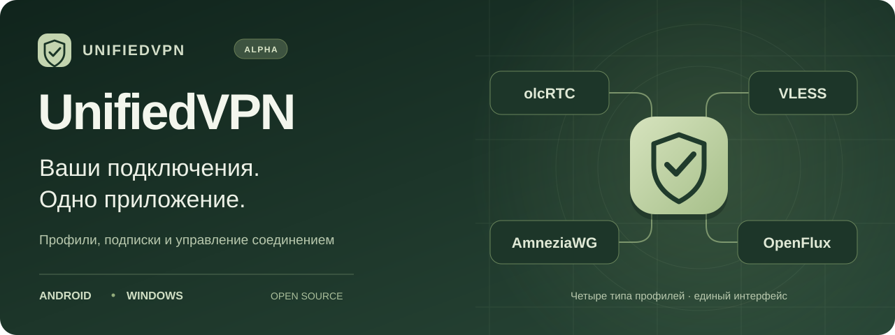
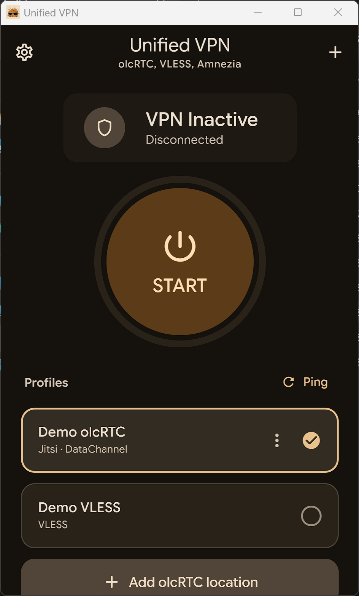
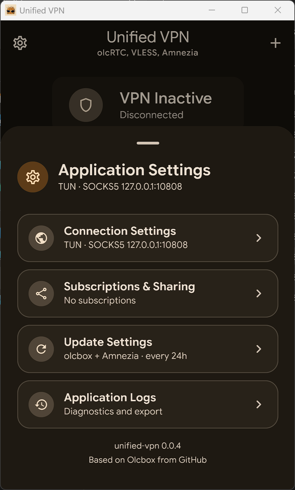
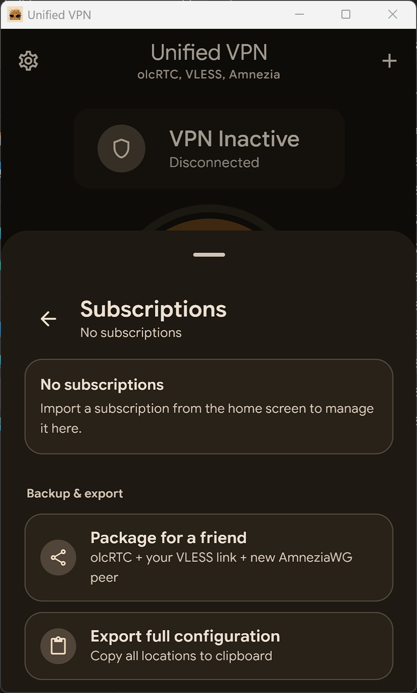

  

<h1 align="center">UnifiedVPN</h1>

  VPN-клиент для <strong>Android и Windows</strong>. 
  Добавьте подписку или готовый профиль — и управляйте подключениями в одном месте.

  <a href="#download"><strong>Скачать</strong></a> ·
  <a href="#start">Быстрый старт</a> ·
  <a href="#features">Возможности</a> ·
  <a href="#docs">Документация</a> ·
  <a href="#english">English</a>

  <a href="https://github.com/JosephTagirov/UnifiedVpn/releases/tag/v0.1.4">v0.1.4 · build 2026110202</a> &nbsp; / &nbsp;
  Alpha &nbsp; / &nbsp;
  <a href="LICENSE">MIT License</a>

---

## Скачать приложение

  
  

| Android 6+ | Windows x64 |
| :--- | :--- |
| [**Скачать APK**](https://github.com/JosephTagirov/UnifiedVpn/releases/download/v0.1.4/UnifiedVPN-android-v0.1.4-build.2026110202.apk) | [**Скачать ZIP**](https://github.com/JosephTagirov/UnifiedVpn/releases/download/v0.1.4/UnifiedVPN-windows-amd64-v0.1.4-build.2026110202.zip) |
| Откройте APK на телефоне. При обновлении устанавливайте поверх прежней версии, без удаления приложения. | Распакуйте архив целиком и запустите `UnifiedVPN.exe` из распакованной папки. |

  <a href="https://github.com/JosephTagirov/UnifiedVpn/releases/tag/v0.1.4">Что нового и ограничения</a> ·
  <a href="https://github.com/JosephTagirov/UnifiedVpn/releases">Все версии</a> ·
  <a href="https://github.com/JosephTagirov/UnifiedVpn/releases/download/v0.1.4/SHA256-build-2026110202.json">Контрольные суммы SHA-256</a>

> **Альфа-версия.** Скорость и доступность зависят от сети. В 0.1.4 опубликованы Android APK и Windows ZIP; нового Linux-пакета и собственного iOS-приложения в этой поставке нет.

## Одно место для ваших подключений

| Профили и подписки | Управление соединением |
| :--- | :--- |
| **Четыре типа профилей.** olcRTC, VLESS, AmneziaWG и экспериментальный OpenFlux в одном списке. | **Подключение одним нажатием.** Выбор профиля, текущий статус и проверка доступности. |
| **Удобный импорт.** Ссылка подписки, URI, буфер обмена или файл конфигурации. | **Настройки под задачу.** VPN/TUN и прокси; доступность режимов зависит от платформы и движка. |
| **Обмен профилями.** Экспорт и защищённые паролем пакеты для друзей с отдельным AmneziaWG-профилем. | **Диагностика рядом.** Просмотр и экспорт журналов, обновление подписок из приложения. |

## От установки до подключения — три шага

1. **Установите приложение.** Выберите Android или Windows в блоке скачивания.
2. **Добавьте профиль.** Нажмите **«+»**, вставьте ссылку подписки или импортируйте готовую конфигурацию.
3. **Подключитесь.** Выберите профиль и нажмите **«Подключиться»**. Для загрузки изменений с сервера используйте **«Обновить подписки»** в меню **«+»**.

Приложение работает с вашими профилями и подписками. Для подключения нужна готовая конфигурация от администратора или вашего сервера.

### В выпуске 0.1.4

Добавлен **Салют Jazz (DataChannel)** для Android и Windows: подключение, HTTPS-проверка пинга и реконнект. Реализована поддержка **МТС Линк (VP9)**, но она требует настроенной постоянной встречи; успешное подключение пока не подтверждено.

В некоторых сетях **VK Calls** использует вспомогательный OpenFlux-канал сигналинга. Работа в белых списках МегаФона, на физических Android 17 / One UI 9, Galaxy Fold и iPhone текущими проверками не подтверждена. Результаты и границы проверок перечислены в [описании релиза](https://github.com/JosephTagirov/UnifiedVpn/releases/tag/v0.1.4).

<strong>Посмотреть скриншоты раннего интерфейса</strong>

Снимки демонстрируют управление профилями и настройки ранней версии. Оформление актуальной версии отличается.

  
  
  

## Документация и участие

| Что нужно | Куда перейти |
| :--- | :--- |
| Разобраться в движках и форматах | [Движки и протоколы](docs/ENGINES.md) |
| Собрать приложение из исходников | [Требования, команды и результаты сборки](docs/REFERENCE.md#requirements) · [на русском](docs/REFERENCE.md#требования) |
| Настроить защищённый обмен профилями | [Пакеты для друзей](docs/REFERENCE.md#безопасные-пакеты-для-друзей) |
| Посмотреть историю изменений | [Релизы на GitHub](https://github.com/JosephTagirov/UnifiedVpn/releases) · [CHANGELOG](CHANGELOG.md) |
| Сообщить об ошибке или предложить улучшение | [Issues](https://github.com/JosephTagirov/UnifiedVpn/issues) |

При описании ошибки укажите версию и сборку, платформу, тип профиля и шаги воспроизведения. Перед отправкой журнала удалите ключи, пароли и приватные ссылки.

<strong>English — overview, downloads and getting started</strong>

### Your connections. One application.

**UnifiedVPN** is an Android-first VPN client with **olcRTC, VLESS, AmneziaWG and experimental OpenFlux** profiles. Import a subscription or a configuration and manage your connections from one interface.

**Current release: [v0.1.4 · build 2026110202](https://github.com/JosephTagirov/UnifiedVpn/releases/tag/v0.1.4).**

- [**Download Android APK**](https://github.com/JosephTagirov/UnifiedVpn/releases/download/v0.1.4/UnifiedVPN-android-v0.1.4-build.2026110202.apk) — Android 6+. Install over the existing app when updating.
- [**Download Windows ZIP**](https://github.com/JosephTagirov/UnifiedVpn/releases/download/v0.1.4/UnifiedVPN-windows-amd64-v0.1.4-build.2026110202.zip) — x64 portable package. Extract the entire archive and run `UnifiedVPN.exe`.
- [**SHA-256 checksums**](https://github.com/JosephTagirov/UnifiedVpn/releases/download/v0.1.4/SHA256-build-2026110202.json).

To get started, install the app, use **+** to import your subscription or profile, select a profile and connect. A configuration from your administrator or your own server is required.

This is **alpha software**. Availability and speed depend on the network. Release 0.1.4 adds Salyut Jazz and MTS Link configuration support; a successful MTS Link connection has not yet been verified. VK Calls may require an auxiliary OpenFlux signaling channel in some networks. This release includes no new Linux package or native iOS app. See the [release notes](https://github.com/JosephTagirov/UnifiedVpn/releases/tag/v0.1.4) for tested scenarios and limitations.

[Technical reference](docs/REFERENCE.md#english) · [Engines](docs/ENGINES.md) · [Issues](https://github.com/JosephTagirov/UnifiedVpn/issues)

---

Основан на [**olcbox**](https://github.com/alananisimov/olcbox) Алана Анисимова. Спасибо автору оригинального приложения и разработчикам используемых движков. Лицензия — [MIT](LICENSE).

Проект предназначен для разработки, тестирования и исследований. Автор не гарантирует доступность подключения или совместимость с сервисами. Используйте программу в соответствии с применимым законодательством; она не предназначена для нарушения ограничений доступа. [Полное уведомление](docs/REFERENCE.md#юридическое-уведомление).
