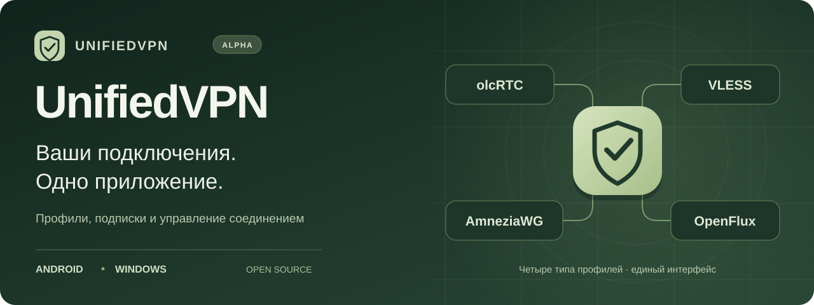
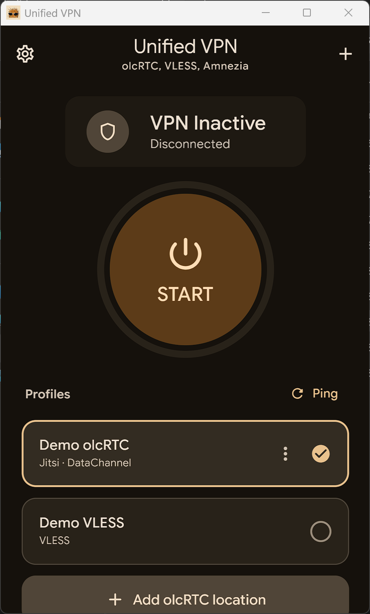
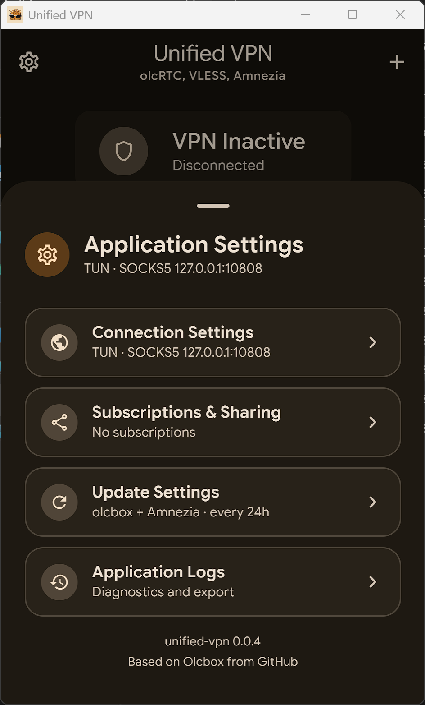
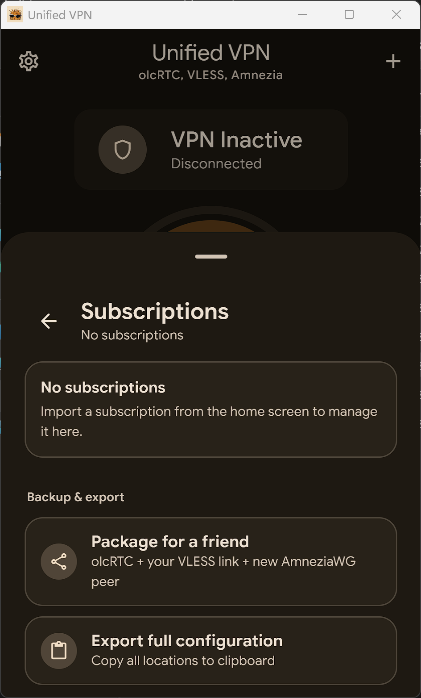

  

<h1 align="center">UnifiedVPN</h1>

  VPN-клиент для <strong>Android и Windows</strong>. 
  Добавьте подписку или готовый профиль — и управляйте подключениями в одном месте.

  <a href="#download"><strong>Скачать</strong></a> ·
  <a href="#start">Быстрый старт</a> ·
  <a href="#features">Возможности</a> ·
  <a href="#docs">Документация</a> ·
  <a href="#english">English</a>

  <a href="https://github.com/JosephTagirov/UnifiedVpn/releases/tag/v0.1.8">v0.1.8 · build 2026110305</a> &nbsp; / &nbsp;
  Alpha &nbsp; / &nbsp;
  <a href="LICENSE">MIT License</a>

---

## Скачать приложение

  
  

| Android 6+ | Windows x64 |
| :--- | :--- |
| [**Скачать APK**](https://github.com/JosephTagirov/UnifiedVpn/releases/download/v0.1.8/UnifiedVPN-0.1.8-build.2026110305-android-universal.apk) | [**Скачать установщик EXE**](https://github.com/JosephTagirov/UnifiedVpn/releases/download/v0.1.8/UnifiedVPN-0.1.8-build.2026110305-windows-amd64-installer.exe) |
| Откройте APK на телефоне. При обновлении устанавливайте поверх прежней версии, без удаления приложения. | Запустите установщик: он обновит установленную копию и сохранит настройки. Открытая переносная копия в другой папке не мешает обновлению. [Portable ZIP](https://github.com/JosephTagirov/UnifiedVpn/releases/download/v0.1.8/UnifiedVPN-0.1.8-build.2026110305-portable-manual.zip) можно распаковать в отдельную папку. |

  <a href="https://github.com/JosephTagirov/UnifiedVpn/releases/tag/v0.1.8">Что нового и ограничения</a> ·
  <a href="https://github.com/JosephTagirov/UnifiedVpn/releases">Все версии</a> ·
  <a href="https://github.com/JosephTagirov/UnifiedVpn/releases/download/v0.1.8/SHA256-build-2026110305.json">Контрольные суммы SHA-256</a>

> **Альфа-версия.** Скорость и доступность зависят от сети. Проверка Яндекса в OpenFlux пока нестабильна. В 0.1.8 доступны Android APK, Windows EXE и portable ZIP; нового Linux-пакета и собственного iOS-приложения в этой поставке нет.

В 0.1.8 исправлен установщик Windows: открытая переносная копия больше не блокирует обновление ошибкой 1603. Проверка учитывает полный путь процесса. Сохранены настройки VLESS/XHTTP для Android и Windows,
ускорено отключение OpenFlux, добавлена подсказка создания ссылки VK Calls
и новое окно установки Windows с проверкой уже установленной версии.
Подробности: [изменения](CHANGELOG.md), [установка](docs/WINDOWS_SETUP.md),
[механизм адблока](docs/AD_BLOCKING.md) и [проверки](docs/testing/vless-openflux-installer-2026110301.md).

## Одно место для ваших подключений

| Профили и подписки | Управление соединением |
| :--- | :--- |
| **Четыре типа профилей.** olcRTC, VLESS, AmneziaWG и экспериментальный OpenFlux в одном списке. | **Подключение одним нажатием.** Выбор профиля, текущий статус и проверка доступности. |
| **Удобный импорт.** Ссылка подписки, URI, буфер обмена или файл конфигурации. | **Настройки под задачу.** VPN/TUN и прокси; доступность режимов зависит от платформы и движка. |
| **Обмен профилями.** Экспорт и защищённые паролем пакеты для друзей с отдельным AmneziaWG-профилем. | **Диагностика рядом.** Просмотр и экспорт журналов, обновление подписок из приложения. |

## От установки до подключения — три шага

1. **Установите приложение.** Выберите Android или Windows в блоке скачивания.
2. **Добавьте профиль.** Нажмите **«+»**, вставьте ссылку подписки или импортируйте готовую конфигурацию.
3. **Подключитесь.** Выберите профиль и нажмите **«Подключиться»**. Для загрузки изменений с сервера нажмите **«Обновить подписку»** на главном экране.

Приложение работает с вашими профилями и подписками. Для подключения нужна готовая конфигурация от администратора или вашего сервера.

### В выпуске 0.1.8

В одной сборке объединены **блокировка рекламы**, обновлённый **OpenFlux** и кнопка **«Обновить подписку»**. Добавлены проверка другого активного VPN, автоматический выбор прокси, VPN/TUN для AWG и VLESS и исправления XHTTP. Адблокер включён по умолчанию и отключается в настройках подключения после переподключения.

Все 860 JVM/Android host-теста прошли; VLESS/XHTTP проверен с включённым адблокером в итоговом Windows-пакете. Получение конфигурации старого редактора Яндекса прошло один раз, повтор завершился тайм-аутом: устойчивое OpenFlux-соединение через новые документы и Volga пока не подтверждено. Итоговый APK на физическом Android ещё не проверен. Подробнее — [проверки объединённой сборки](docs/testing/windows-portable-update-2026110305.md).

### Из предыдущего выпуска 0.1.4

Добавлен **Салют Jazz (DataChannel)** для Android и Windows: подключение, HTTPS-проверка пинга и реконнект. Реализована поддержка **МТС Линк (VP9)**, но она требует настроенной постоянной встречи; успешное подключение пока не подтверждено.

В некоторых сетях **VK Calls** использует вспомогательный OpenFlux-канал сигналинга. Работа в белых списках МегаФона, на физических Android 17 / One UI 9, Galaxy Fold и iPhone текущими проверками не подтверждена. Результаты и границы проверок перечислены в [описании релиза](https://github.com/JosephTagirov/UnifiedVpn/releases/tag/v0.1.4).

<strong>Посмотреть скриншоты раннего интерфейса</strong>

Снимки демонстрируют управление профилями и настройки ранней версии. Оформление актуальной версии отличается.

  
  
  

## Документация и участие

| Что нужно | Куда перейти |
| :--- | :--- |
| Разобраться в движках и форматах | [Движки и протоколы](docs/ENGINES.md) |
| Собрать приложение из исходников | [Требования, команды и результаты сборки](docs/REFERENCE.md#requirements) · [на русском](docs/REFERENCE.md#требования) |
| Настроить защищённый обмен профилями | [Пакеты для друзей](docs/REFERENCE.md#безопасные-пакеты-для-друзей) |
| Посмотреть историю изменений | [Релизы на GitHub](https://github.com/JosephTagirov/UnifiedVpn/releases) · [CHANGELOG](CHANGELOG.md) |
| Сообщить об ошибке или предложить улучшение | [Issues](https://github.com/JosephTagirov/UnifiedVpn/issues) |

При описании ошибки укажите версию и сборку, платформу, тип профиля и шаги воспроизведения. Перед отправкой журнала удалите ключи, пароли и приватные ссылки.

<strong>English — overview, downloads and getting started</strong>

### Your connections. One application.

**UnifiedVPN** is an Android-first VPN client with **olcRTC, VLESS, AmneziaWG and experimental OpenFlux** profiles. Import a subscription or a configuration and manage your connections from one interface.

**Current release: [v0.1.8 · build 2026110305](https://github.com/JosephTagirov/UnifiedVpn/releases/tag/v0.1.8).**

- [**Download Android APK**](https://github.com/JosephTagirov/UnifiedVpn/releases/download/v0.1.8/UnifiedVPN-0.1.8-build.2026110305-android-universal.apk) — Android 6+. Install over the existing app when updating.
- [**Download Windows installer**](https://github.com/JosephTagirov/UnifiedVpn/releases/download/v0.1.8/UnifiedVPN-0.1.8-build.2026110305-windows-amd64-installer.exe) — x64. Setup updates the installed copy and preserves settings. A running portable copy in another folder does not block setup. [Portable ZIP](https://github.com/JosephTagirov/UnifiedVpn/releases/download/v0.1.8/UnifiedVPN-0.1.8-build.2026110305-portable-manual.zip) is also available.
- [**SHA-256 checksums**](https://github.com/JosephTagirov/UnifiedVpn/releases/download/v0.1.8/SHA256-build-2026110305.json).

To get started, install the app, use **+** to import your subscription or profile, select a profile and connect. A configuration from your administrator or your own server is required.

Release 0.1.8 adds owner messages and subscription expiry reminders. Windows setup retains the installation path guard introduced in 0.1.7. Setup now checks the installed executable path. Local ad blocking, OpenFlux diagnostics and subscription refresh are retained. All 870 JVM/Android host tests passed; packaged Windows VLESS/XHTTP HTTPS worked with filtering enabled. **This is alpha software:** Yandex verification remains intermittent, stable OpenFlux traffic through the new documents and Volga is unverified, and the final APK has not been tested on physical Android. Availability and speed depend on the network. See the [release notes](https://github.com/JosephTagirov/UnifiedVpn/releases/tag/v0.1.8) for tested scenarios and limitations.

[Technical reference](docs/REFERENCE.md#english) · [Engines](docs/ENGINES.md) · [Issues](https://github.com/JosephTagirov/UnifiedVpn/issues)

---

Основан на [**olcbox**](https://github.com/alananisimov/olcbox) Алана Анисимова. Спасибо автору оригинального приложения и разработчикам используемых движков. Лицензия — [MIT](LICENSE).

Проект предназначен для разработки, тестирования и исследований. Автор не гарантирует доступность подключения или совместимость с сервисами. Используйте программу в соответствии с применимым законодательством; она не предназначена для нарушения ограничений доступа. [Полное уведомление](docs/REFERENCE.md#юридическое-уведомление).
